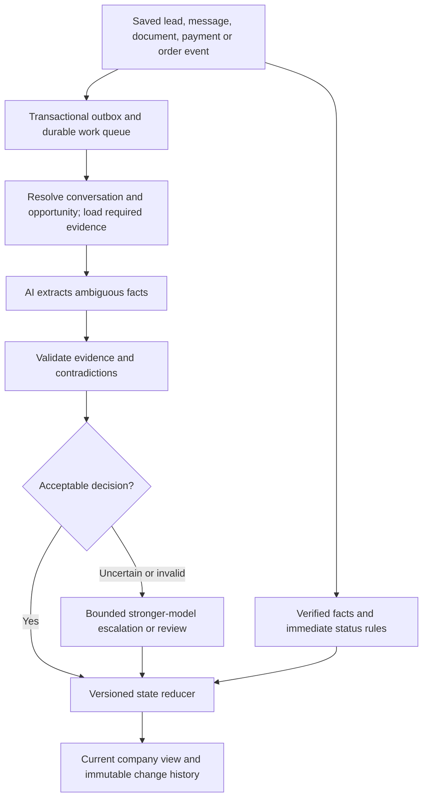

# Auto tagging architecture review and redesign

The audit found an active tagging pipeline whose business model did not represent the requested workflow. Customers could receive a sales reply and still be classified as New Inquiries because that tag included requirements qualification. There was no Contacted state. Replacing the language model alone would not resolve this mismatch.

The recommended design separates observed communication status, sales opportunity stage, customer relationship, and processing health. Confirmed CRM events update facts through deterministic rules. AI extracts ambiguous meaning from email and proposes evidence-backed facts; it does not directly control the authoritative customer state.

The owner confirmed on November 20, 2026 that the company list should show **Contacted — waiting for customer** after the team replies to a new inquiry, and then authorized implementation. The research baseline below is retained for comparison; implementation status is recorded here separately.

**Implementation on November 20**

- Applied the `customer_tag_rules_and_queue` database migration. Durable company revisions and expiring leases fence stale AI commits; manual assignments survive the company projection. Tenant isolation and server-only access were verified with rollback integration fixtures.
- Reconciled saved sent messages, CRM emails and mailbox snapshots without AI requests. The legacy workspace produced 940 relevant header facts, with 88 companies having linked outgoing replies awaiting a customer response and five having later customer replies. These are derived communication facts, not a semantic accuracy score.
- Added event-driven payment, active-order, completed-and-settled repeat-purchase and shared-quotation rules. Inactivity requires an existing configured live dormant-customer flow, fresh receiving coverage and no open commitments; no threshold was invented.
- Added a concise structured semantic classifier using Haiku 5.5 with at most one escalation to GPT-6.2 Sol. Exact source evidence, confidence checks, explicit keep/clear/review outcomes, budget enforcement, policy checks and model/guidance fingerprints protect semantic changes. Rules and unchanged inputs avoid model calls.
- Added visible pending, paused, retrying, missing-history and review states. The queue retains changed input through cooldowns and never treats uncertainty as successful reclassification.
- Verification: 59 focused tests and the isolated release's 2,606-test suite passed. The additional freshness test and five scheduler route tests passed after the final endpoint changes. Lint, TypeScript and local and Vercel production builds passed. Database tests passed for communication with AI disabled, partial and full payments, order completion, distinct repeat purchases, valid and accepted quotes, metadata idempotency, queue ownership, stale decision rejection, explicit clearing and cross-workspace isolation.
- Real-data check: Albert completed at company revision 5 with one Haiku 5.5 request (1,973 input / 175 output tokens), no escalation and no failure. The company remained Contacted, processing health became current, and an unchanged rerun made zero provider calls. Native browser inspection confirmed the corrected Companies badges for Albert, Moab and Alex Albuquerque and preservation of Wasteland's manual Prospect Nurturing assignment.
- Deployment: promoted production deployment `dpl_2Xx9M9ywEAAuUsz5h9j21Y9bMQbV` to `https://crm.filazoosupply.com` on November 20. The custom domain resolves to that READY deployment and its sign-in page returned HTTP 200. The protected scheduler rejected unauthenticated access. Unrelated uncommitted company-screen and email changes were excluded from this release.
- Freshness: the company revision probe now includes rule/health updates, and the tag diagnostic allows a bounded inference window for each parallel workspace instead of dividing it by every tenant. Applied migration files match the database migration versions.

Remaining limits: the history loader still requires every mailbox source to succeed before interpreting a combined thread. Oversized or unavailable history is held for review/recovery instead of silently truncated. The synthetic model benchmark is small and does not establish production accuracy. Existing conversation assignments are preserved for audit; the company projection suppresses only explicitly linked stale inquiry labels. Historical semantic work remains queued and is processed in bounded batches. The bundle audit passes the Companies list budget (410,542 / 420,000 gzip bytes), but five other route/entry budgets remain exceeded, including company detail; those thresholds were not changed. This implementation does not guarantee zero failures or automatically send payment reminders.

**Observed behavior and gaps**

Read-only production checks on November 20 found 201 companies with a New Inquiries assignment. Seventy of those companies also have at least one sent message saved in the CRM for a linked contact. This is a candidate review set, not a measured error rate: a message may concern a different inquiry or opportunity.

| Finding | Evidence | Consequence |
| --- | --- | --- |
| Replied is absent from the vocabulary | [Shared vocabulary](../lib/customer-tags.ts), [classifier instructions](../lib/ai/conversation-tagging.ts) | A correct model response under the present definitions can still look wrong to the salesperson. |
| Low confidence preserves the old tag | Alex Albuquerque's latest analysis returned confidence 0.8 and no tag; the import rule's New Inquiries remains | A completed analysis is not necessarily a current or accepted classification. |
| The company view unions distinct conversation tags | [Company mapping](../lib/data/crm.ts) aggregates every distinct nonnull assignment | An old form inquiry can remain visible alongside a newer situation. |
| Different thread identities can represent related intake and outreach | Wasteland's form retains a rule-based New Inquiries assignment; its separately rooted welcome email has a manual Prospect Nurturing assignment | Updating one conversation does not replace the other assignment. Their relationship needs an explicit opportunity link, not a guess from company name. |
| Replied conversations can remain inquiries even at high confidence | Moab's latest analysis accepted New Inquiries at 0.9 after a saved seller reply | The stage definition, rather than a failed job, can explain the display. |
| Business facts are absent from the model context | The tagging context contains messages and workspace guidance, without authoritative invoice, payment, or purchase-order records | Financial and fulfillment labels depend on what email says instead of the underlying transaction record. |
| Preserving and clearing are conflated | The classifier defines null as keeping the existing assignment | Uncertainty, irrelevant mail, a completed order with no suitable label, and an intentional removal cannot be distinguished. |
| Recovery is incomplete | Thirty-three linked customer analyses were skipped for missing or oversized history; zw casting's latest failed analysis was at evidence validation after 14 total attempts | Repeating the same request or silently preserving a badge does not resolve the dependency or explain the problem to staff. |
| Inference uses one default model tier | [Routing](../lib/ai/model-routing.ts) sends tagging to the simple tier, defaulting to Gemini 2.5 Flash Lite; [Gateway](../lib/ai/gateway.ts) retries the selected model | No application-level escalation exists for uncertain or invalid tagging decisions. Saved tagging metrics do not record the actual serving model. |
| Cache identity omits automatic model and policy revision changes | [Input fingerprint](../lib/ai/conversation-tagging.ts) includes a static analysis version and message metadata | Changing a model or prompt does not automatically reassess unchanged completed conversations. A version bump or explicit reprocessing policy is necessary. |
| Work is discovered by broad scans | [Worker](../lib/data/conversation-tagging.ts) loads shared contacts, mailbox histories, and analysis rows; it repeats history loading before committing a result | Growing mailbox volume increases work per small batch. One source-loading failure can prevent the combined-history run from producing candidates. |

Useful safeguards already exist: workspace scoping, verified contact matching, message identity deduplication, expiring leases, input revalidation, evidence checking, manual-change protection, and retry backoff. Preserve these while replacing the state model and work-discovery path.

**State that the CRM should store**

| Dimension | Examples | Authority |
| --- | --- | --- |
| Communication status | Unanswered inquiry; Contacted — waiting for customer; Customer responded | Successfully saved, linked inbound and sent events, with automatic responses and drafts identified separately |
| Opportunity stage | Qualifying; Quoted; Negotiating; Awaiting payment; Fulfillment; Completed; Lost; Paused | Versioned business rules using verified records and validated semantic facts |
| Next action | Ask for specifications; Review counteroffer; Follow up on quotation; Verify payment claim; None | Rules plus validated interpretation, with an owner and optional due date |
| Customer relationship | Prospect; First-time customer; Repeat customer; Inactive | Company-wide purchase and activity records with explicitly configured definitions |
| Processing health | Current; Pending; Waiting for history; Needs review; Retrying; Failed | Durable job and input-revision records |

After a substantive sales reply is confirmed as sent for a new inquiry, show Contacted — waiting for customer immediately. Requirements qualification may continue internally. A draft, failed send, internal forward, or unrelated campaign does not satisfy that rule. SMTP acceptance should be described as sent, without pretending that delivery has been confirmed. A later bounce creates a delivery exception.

If a buyer sends a meaningful response, record Customer responded and determine the next action. A thank-you, out-of-office response, or delivery receipt must not automatically imply a sales negotiation or a required human reply. Preserve its observed communication facts even when semantic interpretation is pending.

Track stage per opportunity. A repeat customer can have a completed order, a new unanswered inquiry, and another active negotiation at the same time. The company summary should prioritize unresolved commitments and action needs, show the number of active opportunities, and expose the underlying threads. Retain historical labels in the timeline rather than combining all of them into an unexplained current-stage list.

**Recommended processing architecture**

Use the existing Next.js, Postgres, and Gateway stack. This is a bounded workflow whose transitions should be owned by code. A general autonomous agent loop or a collection of independent agents adds little value to a task with defined inputs and states. This choice follows the predictable-workflow and routing patterns described by [Anthropic](https://www.anthropic.com/research/building-effective-agents).

1. Save the business event and its outbox entry in the same database transaction. Consume at least once with idempotent effects, per-opportunity ordering, and duplicate detection. Keep cron as a reconciliation and recovery path. The [transactional outbox pattern](https://docs.aws.amazon.com/prescriptive-guidance/latest/cloud-design-patterns/transactional-outbox.html) addresses the gap between committing a record and notifying downstream work; it does not remove the need to handle duplicates.
2. Carry immutable workspace, contact, inquiry, conversation, and opportunity identifiers through intake, workflow enrollment, sending, and provider imports. Use explicit intake origin and RFC message relationships. Do not merge unrelated purchases because subjects or company names match. Uncertain opportunity associations go to review.
3. Apply observed facts independently of model availability. A verified reply updates communication status; an actual quote-send event records which document version was sent; invoice settlements and order transitions update their corresponding facts. Mere draft creation or an attachment filename is insufficient evidence of quotation delivery.
4. Have AI extract a small typed result: buyer intent, requested next action, counteroffer or postponement, relevant opportunity, missing information, and evidence references. Store message and document identities, speaker, timestamp, and exact source spans. Treat email instructions as untrusted content. A valid schema does not guarantee a correct decision; [structured outputs can still contain mistakes](https://developers.openai.com/api/docs/guides/structured-outputs).
5. Validate source ownership, evidence spans, negation, chronology, record contradictions, and completeness. Give each semantic decision an explicit outcome: apply, no change, clear obsolete semantic label, abstain, or review. A semantic clear operation cannot erase a verified payment record or override a protected human decision.
6. Escalate difficult or invalid cases once to an independently evaluated stronger model. Do not lower evidence standards merely to produce a label. Provider outages use bounded technical retries or validated provider/model failover; repeated semantic failures use review rather than indefinite same-input retries. [Gateway model fallbacks](https://vercel.com/docs/ai-gateway/models-and-providers/model-fallbacks) help availability but do not prove the fallback's answer correct.
7. Commit through a deterministic reducer using a revision check. If the conversation changed during analysis, discard the outdated proposal and queue the newest revision. Store the applied rule, evidence, prompt/schema/model versions, actual serving model, input revision, and timing. Keep manual overrides with an explicit scope and expiry rule.
8. Treat missing history as a resumable dependency. Enqueue the required import, resume when its revision changes, and isolate unrelated conversations from a failed mailbox. For long threads, retain source-backed extracted facts and targeted original messages; do not silently classify an incomplete truncated history. Free-form summaries alone cannot serve as authoritative evidence.

Financial and operational boundaries belong in the reducer: an email saying "I paid" creates a payment-verification task, not a settled invoice. Fulfillment requires an accepted active order. Repeat-customer status comes from qualifying completed purchases. Completion retires the opportunity's active stage. Time-based inactivity uses a configured company-wide threshold; explicit postponement remains a separate fact with its promised follow-up date.

**Model comparison**

A live synthetic comparison used the same proposed stage definitions and strict response schema for four models, with 12 independent requests per model. Cases covered first replies, promised versus sent quotations, negotiation, unverified payment claims, fulfillment, completed orders, Portuguese postponement, Spanish negotiation, drafts, prompt injection, and opt-out. No customer email was sent to the test models. The [full results and fixtures](audit-evidence/auto-tagging-model-smoke-20261120.json) are saved for inspection.

| Model | Correct stage | Stage plus valid source citation | Median request time | Estimated test cost |
| --- | --- | --- | --- | --- |
| Gemini 2.5 Flash Lite | 12/12 | 11/12 | 1.20 seconds | $0.00071 |
| Claude Haiku 5.5 | 12/12 | 12/12 | 1.26 seconds | $0.00149 |
| Gemini 3.8 Flash | 12/12 | 12/12 | 2.01 seconds | $0.00663 |
| GPT-6.2 Sol | 12/12 | 12/12 | 2.13 seconds | $0.01624 |

The current-model fixture failure was a citation-validation failure despite the correct stage. All four correctly kept the first-reply fixture in the qualifying sales stage. The desired Contacted display must therefore come from the separate communication state. The comparison tested the proposed prompt, not the complete current production classifier.

The [comparison script](audit-evidence/auto-tagging-model-smoke-20261120.mjs) can be rerun with `node --env-file=.env.local docs/audit-evidence/auto-tagging-model-smoke-20261120.mjs`. It sends only the included synthetic fixtures, uses a $0.50 conservative preflight cap, and writes a fresh result under `tmp/`. Rerunning makes paid Gateway requests; provider behavior and timings can change. It does not call the production routing selector or update CRM records.

Total usage-based estimated cost was $0.02507, below a conservative preflight quote of $0.47851 and a $0.50 cap. These are token-price estimates, not a billing statement. Results are one run of 12 relatively short synthetic cases, not a production accuracy percentage, calibration study, or statistically established model ranking.

The initial candidate is **Claude Haiku 5.5 for routine semantic extraction, GPT-6.2 Sol for bounded escalation**, with Gemini 3.8 Flash as an evaluated alternate. Haiku's observed latency and low cost make it a practical starting candidate; this smoke test does not prove it is universally more accurate. All observed sent/payment/order rules should run without a model. Current [Gateway catalog](https://ai-gateway.vercel.sh/v1/models) rates per million uncached input/output tokens were $0.10/$0.50 for Haiku, $2/$10 for Sol, $0.75/$3.75 for Gemini 3.8 Flash, and $0.10/$0.40 for the baseline. Catalog rates and provider availability can change.

Keep model selection specific to this workflow. The existing routing allowlist and tests intentionally constrain available models; model pricing and budget policy must be reviewed with any implementation change. A model switch alone also needs an explicit cache-version/reprocessing decision.

**Rules first to minimize model usage**

The owner's follow-up prioritizes code-based tagging for inactivity, repeat customers, fulfillment, and payment follow-up. The repository already contains usable structured inputs: purchase-order statuses, invoice balances and payment records, invoice due dates and successful-send timestamps, a catalog quotation lifecycle with shared/accepted states, and a company inactivity query. These are inputs to connect and reconcile; the existing conversation classifier does not currently consume them as authoritative stage facts.

| Tag or status | Proposed deterministic rule | Removal or transition |
| --- | --- | --- |
| New Inquiries | Verified inquiry intake for an opportunity with no qualifying seller reply | A confirmed linked reply changes communication status to Contacted; do not change unrelated inquiries |
| Contacted — waiting for customer | A substantive sales reply was successfully sent for that inquiry | Later buyer activity updates the response state; bounces produce a delivery exception |
| Quotation Follow-up | A valid quote version was recorded as shared through the quotation lifecycle, with customer feedback still pending | Acceptance, rejection, cancellation, supersession, expiry, or a validated counteroffer updates the next action/stage |
| Payment Follow-up | An issued, communicated invoice for an agreed purchase has a positive remaining balance; follow-up eligibility uses its due date and structured installment terms | Recompute on payment, credit/void, dispute, or payment-plan change; distinguish awaiting payment from overdue |
| Orders in Fulfillment | A distinct linked order is confirmed and proceeding, in production, or shipped, with no completion/cancellation | Recompute on order changes; if confirmed but blocked on a required deposit, expose the payment blocker rather than claiming production has started |
| Repeat Customers | At least two distinct qualifying completed purchases, using an agreed settlement/refund policy | Recompute if a qualifying purchase is invalidated; never count split invoices or deposits as separate purchases |
| Inactive Customers | No qualifying company-wide buyer/purchase activity within the configured window, with reliable coverage and no open commitments or future agreed follow-up | Clear/reassess on new buyer activity, new purchase, corrected history, or a threshold change |
| Prospect Nurturing | Explicit prospect-list/pipeline membership and no qualified active opportunity, with outreach permitted | A qualified inquiry, opt-out, or disqualification changes eligibility |
| Active Negotiations | Explicit staff stage changes are deterministic; unstructured buyer counteroffers or revised terms require contextual interpretation | Reassess only relevant new evidence for the same opportunity |

For payment rules, use [invoice send tracking](../app/api/invoices/[id]/send/route.ts), the invoice ledger and due date, and [order payment-policy fields](../lib/purchase-orders.ts). The existing free-text custom payment terms are not a reliable machine-readable installment schedule; extract and validate them once or record the schedule explicitly before automatic due-date decisions. An invoice being issued alone does not prove it was communicated or that every outstanding amount is already due.

For quotations, reuse the [existing quotation lifecycle](../supabase/migrations/20261030093408_catalog_quotation_lifecycle.sql), rather than assuming that every catalog email or attachment is a valid quote. For inactivity, reuse and extend the [existing dormant-customer calculation](../lib/data/dormant-customers.ts): separate buyer engagement from staff outreach, include all relevant activity channels, exclude automatic campaigns from resetting buyer inactivity, and check payment/commitment blockers. The current query already excludes open orders and some scheduled work, but it is not a complete definition of buyer inactivity.

Repeat-customer relationship, payment tasks, and fulfillment state can coexist. Apply rules per fact dimension and per opportunity instead of forcing one global winning tag. A repeat customer with an active order and a due balance should retain all three facts, with the payment action prioritized in the current work view.

Use AI only for unresolved meaning: counteroffers, explicit postponement, ambiguous next actions, externally sent quotes without structured metadata, and uncertain opportunity associations. Do not replace contextual interpretation with word matching such as paid, quote, thanks, or OK. If an existing AI reply/summary call already reads the same source revision, it can return validated facts in the same response, avoiding a second tagging request. Draft generation cannot establish that a reply or quote was actually sent.

Cost controls should avoid work as well as reduce token prices: enqueue only affected opportunities, reuse unchanged decisions, debounce reply bursts, preserve source-backed extracted facts with links to original text, retrieve additional history when needed, and run inactivity rules on a schedule without asking a model to check elapsed time. A stronger-model escalation should occur only after a specific uncertainty or validation failure. Provider prompt caching is an additional optimization, not the mechanism for avoiding duplicate analyses.

For the earlier illustrative volume of 10,000 conversations with five potential classification events each, all-AI processing at the assumed 3,000 input/300 output tokens and 10% Sol escalation costs $67.50 in inference. If deterministic rules remove 80% of those AI requests, the same assumptions give $13.50; at 90%, $6.75. These are scenarios, not measured rule coverage or guaranteed monthly prices. Infrastructure, retries, missing-record recovery, and actual context sizes remain separate inputs.

**Evaluation and rollout**

The earlier 58 passing tests verify code contracts and safeguards; they do not establish that real company states are correct. Build an initial set of 200–500 human-reviewed real opportunities, emphasizing the 70 candidate companies while also sampling normal cases. Split training/examples and held-out evaluation by company or opportunity, rather than putting messages from the same thread on both sides. Cover Portuguese and other observed languages, multiple staff mailboxes, attachments, long history, repeated purchases, cancellations, bounces, opt-outs, and incorrect thread associations. Evaluate each stage and language separately. This follows [task-specific evaluation guidance](https://developers.openai.com/api/docs/guides/evaluation-best-practices).

Measure accepted-decision precision, missed transitions, abstention/review coverage, evidence correctness, false financial promotions, waiting time after source events, processing backlog age, recovery completion, and cost per accepted decision. A model's self-reported 0.9 is not evidence that 90% of such decisions are correct. Calibrate acceptance criteria against independently reviewed examples.

Implement in this order:

1. Add the separate communication status and the confirmed Contacted behavior, covering CRM sends and imported Sent messages. Add tests for drafts, failed sends, unrelated outbound messages, later buyer replies, and duplicate events.
2. Establish explicit inquiry/opportunity relationships and a current company projection. Backfill only confidently linked histories; review ambiguous relationships. Preserve manual changes and allow rollback.
3. Introduce event-triggered work, authoritative commercial facts, dependency recovery, and visible processing health. Retain the existing leases and stale-result protections.
4. Add typed extraction, evidence validation, calibrated acceptance, and bounded escalation. Run in shadow mode against the current system and reviewed labels before applying semantic stage changes.
5. Roll out in controlled groups, compare errors and action queues, then reconcile historical assignments. Do not bulk-replace all 70 candidates simply because a sent message exists.

Proposed release gates include correct behavior on every reviewed reply-state case, no known critical financial promotion errors in the release set, explicit health state for every pending/abstained decision, replay/idempotency/tenant-isolation tests, and an agreed semantic precision and coverage target on held-out data. A 99.9% processing-latency objective can be set after measuring realistic load; it is a proposed service objective, not a measured result.

No language model or distributed email pipeline can provide a literal zero-failure guarantee. The practical objective is to make observed facts reliable, restrict uncertain interpretation, detect stale or blocked work, and provide recovery and a review path. This architecture directly addresses the requested Contacted behavior while making the remaining uncertainty inspectable.
