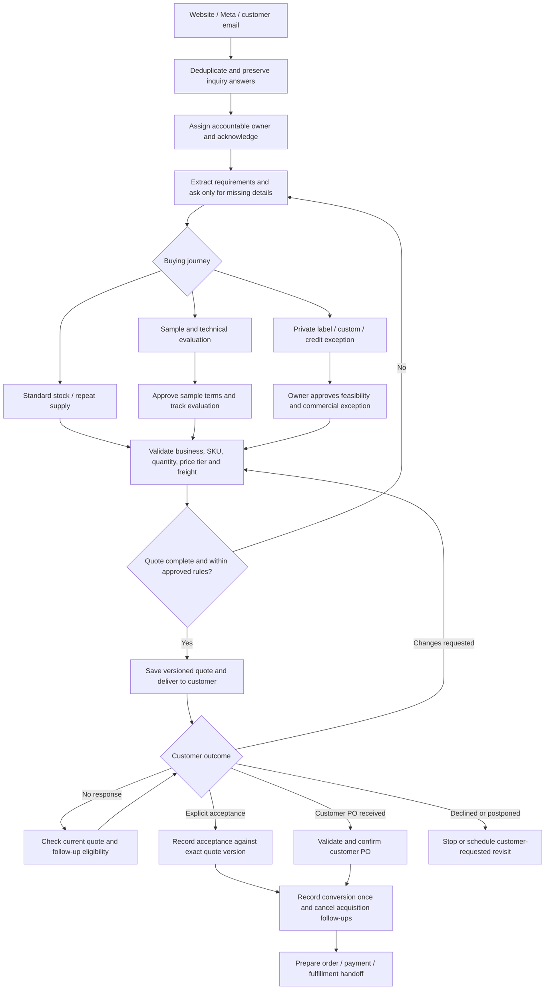

# Filazoo: lead to conversion

Prepared 5 November 2026. Conversion means **an accepted quotation OR a confirmed customer purchase order**, as specified by the owner. Payment and fulfillment happen after conversion.

Later owner refinement: the [one-minute AI reply and personal handoff starter](new-lead-ai-reply-handoff-20261105.md) implements the specifically requested acquisition sequence with a 24-hour reply window and direct assignment to the signed-in creator. That starter supersedes the initial acknowledgment timing proposed below. The original companion JSON remains the earlier design's draft request bodies.

## Business finding

Filazoo needs a purchasing workflow with three buying journeys: repeat filament supply for print farms/service bureaus, assortment and resale for distributors, and custom/private-label production. Treating every inquiry as the same catalog request misses the different information and approvals each journey needs.

The public wholesale offer currently starts at 50 kg mixed materials/colours, offers a sample route after account approval, and describes custom colours from 100 kg per colour. It describes purchasing tiers based on rolling 12-month volume and credit review before net terms. The form already collects monthly volume and optional business, material, location and service requirements. These are public offers to reconcile with approved CRM commercial rules before automation, not prices or shipping promises an AI should calculate from website text. Source: [Filazoo wholesale offer and application](https://filazoo.com/pages/b2b), reviewed 5 November 2026.

Prioritize qualified requirements and a credible commercial offer. A fast generic welcome alone will not produce a ready-to-accept quotation. This is an operational diagnosis from the website and application code; lead-to-quote rates, margin and lost-sale causes have not been measured from live customer records in this review.

## Complete target workflow

This diagram is the target design. The current engine implements only the supported draft workflows below; the quotation/conversion connections remain implementation work.

| Workflow | Trigger and actions | Exit / accountable owner |
| --- | --- | --- |
| 1. Capture and ownership | Accept website/Meta webhook or authorized customer email; deduplicate source event and normalized contact; preserve original answers and source IDs; match the company without merging unrelated personal-email users; keep existing owner or assign an eligible manager. | Invalid/suppressed contact stops outbound delivery. No eligible manager creates an unassigned exception for an administrator. |
| 2. Fast acknowledgment | Proposed target: acknowledge an eligible inquiry after five minutes. Introduce the assigned contact and explain the next step. Use existing form answers rather than asking the customer to complete the form again. | Current five-minute wait adds scheduler/provider latency. Acknowledgment is separate from a complete quote. Owner review remains due within the site's promised business-day window. |
| 3. Qualification | Extract business type, use case, first-order quantity, expected monthly use, materials, exact variants/diameter/spool size, destination, target date and sample/custom/credit requirements. Preserve the source for every extracted fact. Ask at most three missing questions per message. | Conflicting, unsupported or ambiguous requirements go to the owner. Keep order quantity distinct from monthly demand. |
| 4. Product and route selection | Stock buyer: match active SKUs and exact variants. Sample buyer: agree kit, cost and destination, then record dispatch/delivery/evaluation before bulk follow-up. Custom buyer: collect colour/specification/artwork, volume and deadline; obtain feasibility and commercial approval. | Technical suitability, custom feasibility, samples and credit exceptions need evidence. A large requested volume raises priority; it does not authorize a discount. |
| 5. Commercial offer | Validate currency, available product price, per-SKU/variant quantity breaks, account tier, addresses, freight origin/cost, applicable taxes, payment terms, validity and any exception. Save a versioned quotation and relevant product catalog. | No final offer with unknown freight represented as confirmed zero, an unsupported discount, an invented delivery date or unresolved currency. The owner approves exceptions. |
| 6. Follow up | Proposed cadence: two business days after sending, then three additional business days; one final low-pressure check after five more business days. Before each message re-read the exact quote, acceptance/order links, latest replies, postponement, suppression and recent sending. Stop after the final check. | Reply routes to requirements/negotiation; acceptance or confirmed PO cancels acquisition follow-ups. A quote that has expired needs review/revision. Email opens/clicks never establish purchasing intent or conversion. |
| 7. Conversion | Explicit customer acceptance must identify the exact saved quote version. Alternatively, validate and save a confirmed customer PO with quantities, prices, currency and delivery/payment terms. Save supporting evidence and actor. | Create one opportunity conversion record; link subsequent quote-to-PO activity to that record rather than counting a second conversion. A draft PO, a sent quote or an AI label does not qualify. |
| 8. After conversion | Notify the account owner; prepare the order, invoice/payment instructions and operational handoff from approved commercial data. Keep payment and dispatch eligibility tied to their actual records. | Quote conversion currently creates a **draft** PO. It is not a confirmed order or permission to ship. Conversion does not mean money has arrived. |

The timing above is a proposed operating policy, not a measured optimum. The editor's business-hour settings use UTC. Customer-local scheduling needs an explicit time zone and country/region rules; country alone is insufficient for multi-zone markets.

## Qualification and exception rules

- **Print farms/service bureaus:** capture printer setup, regular material/colour demand, acceptable substitutes and replenishment schedule. Recommend a narrow product selection; technical compatibility must come from approved product data.
- **Resellers/distributors:** capture storefront/channel, initial assortment, repeat volume, destination and branding needs. Account-level rolling purchase tiers require purchase history, not just one line's quantity price break.
- **Custom/private label:** collect specification, per-colour/run quantities, packaging/artwork and target date. Request a production/feasibility review before a firm price or deadline.
- **Small orders:** explain the retail route when the approved wholesale threshold is not met, while allowing review for samples or an approved exception. Do not automatically disqualify a promising buyer solely because monthly demand is unknown.
- **Net terms, technical uncertainty, negotiated pricing or unusual shipping:** create an owner task with the missing decision and evidence. Resume after an explicit decision, rather than repeatedly asking the customer or inventing a term.
- **No response:** finish the finite cadence and leave a reviewable record. Silence alone is insufficient evidence for changing a customer to an inactive or lost state.
- **Postponement/decline/unsubscribe:** respect the actual request, stop the acquisition sequence and retain any agreed next-contact date. Inquiry contact permission must not be treated as permission for unrelated long-term marketing.

## What the CRM actually supports

Current source files take precedence over older planning material. `PROJECT.md` contains an outdated prototype inventory; the retired sales-pipeline guidance is also superseded.

| Capability | Evidence in this checkout | Operational implication |
| --- | --- | --- |
| Shopify/Meta intake and deduplication | `lib/shopify-leads.ts`, `lib/meta-lead-bridge.ts`, README intake sections | Reuse the receivers and source-list enrollment. The 5 November theme repair documents published website connectivity, but not a completed real-lead insertion test. |
| Owner assignment | `docs/lead-assignment.md` | Existing ownership takes priority. New pause/capacity/rotation controls have a pending database rollout; do not assume those controls are installed. Verify rollout separately. |
| Persisted waits, conditions, tasks, alerts, email, AI replies | `lib/flows.ts`, `lib/data/flow-runtime.ts`, `docs/workflow-audit-20261105.md` | Supported actions can form the acquisition and review workflows. No quote or PO event is currently an allowed trigger. |
| AI product matching and catalog generation | `lib/data/flow-ai-reply.ts` | Reads authorized email history, a small company/contact context and products. It does **not** load saved wholesale form answers, account purchase-tier history or a saved quotation into its reply prompt. |
| Versioned quotation, acceptance and conversion to draft PO | `lib/data/quotations.ts`, `lib/quotations.ts` | Reuse the validated commercial documents. `accept` is a staff action; the existing customer portal does not supply a quote-acceptance event. |
| Confirmed customer POs and invoices | `docs/purchase-order-audit-2026-10-29.md`, `docs/invoices.md` | Reuse PO confirmation as the alternate conversion boundary. Invoice/payment automation is downstream. |
| Current customer vocabulary | `lib/customer-tags.ts`, `docs/sales-feature-retirement-2026-10-30.md` | Use New Inquiries, Quotation Follow-up and Active Negotiations when supported by evidence. No new sales pipeline or invented Converted tag is needed. |

## Four supported draft definitions

[filazoo-lead-to-conversion.json](workflows/filazoo-lead-to-conversion.json) contains four independent `FlowInput` request bodies. Every definition has `status: draft`:

1. **Website inquiry:** new Shopify B2B source-list contact; create an owner qualification task and in-app alert, wait five minutes, send a restrained AI introduction, wait two business days, then create a review task only if no customer reply has arrived.
2. **Meta inquiry:** the same flow for the Meta source list, keeping the intake audiences separate.
3. **Customer reply review:** a received customer email creates an urgent owner task and an in-app alert. Review covers new requirements, sample requests, objections, acceptance and attached POs. It does not automatically change commercial documents or send a second reply.
4. **Quotation review:** the Quotation Follow-up tag starts a two-business-day wait. Recheck the tag and new replies before creating an owner quote-review task. The task explicitly requires checking the saved quote and linked PO before contacting the customer.

The two intake definitions check for an untagged, Prospect Nurturing or New Inquiries conversation before the introduction. They leave advanced customer conversations untouched. They intentionally do not attach a broad catalog or quote prices before requirements are known. Initial AI guidance cannot compensate for missing form-answer context, so the owner task checks those answers directly.

These are supported building blocks, **not a claim that the target is fully automated**. No draft issues a final quote, records acceptance, confirms an order or marks a conversion. Quotation reminders currently create internal tasks rather than external messages because there is no authoritative quote-status guard in the engine.

Each item under `flows` can be submitted individually to the authenticated `POST /api/flows` API after selecting an authorized sender and reviewing audience/ownership. The JSON is not a built-in bulk-import format. The editor can also recreate the same actions. This review has not submitted them to the live CRM or activated them.

Before any activation, compare the proposed audience and action with existing live flows and per-conversation auto replies; select one owner for each customer-facing response. The earlier audit reported multiple live flows, so adding another welcome without that inventory risks overlapping messages. Use a controlled recipient first. Existing sending/suppression limits still apply.

## Implementation work needed for full automation

Deliver these in dependency order:

1. **Connect inquiry memory.** Expose normalized source answers, attachments and previous requirements to authorized AI generation. Store structured requirements with evidence and missing/conflicting fields. Repeated deliveries must not overwrite a later staff correction. Check the pending assignment migration before relying on its new RPC/settings.
2. **Implement commercial readiness.** Resolve exact variants, approved account tiers and purchase history, currency, stock, freight and terms. Reuse quotation validation and explicitly separate catalog/product information from a binding quote. Permit automatic quotes only inside a configured, approved commercial policy; route exceptions to an owner.
3. **Bridge saved documents to workflow events.** Add durable, idempotent quote-shared, quote-accepted, quote-declined, quote-expired and PO-confirmed events after successful authorized writes. Use quote ID/revision and order ID, reconcile missed events, and re-check document state immediately before any follow-up submission.
4. **Capture acceptance and conversion.** Start with the existing staff acceptance/PO-confirmation actions and recorded evidence. For unattended acceptance, add authenticated customer acceptance of the exact quotation version with an immutable receipt. Atomically record the conversion and cancel outstanding acquisition messages for that opportunity. Deduplicate linked quote/PO activity; do not collapse a company's later independent orders into its first conversion.
5. **Add supervised exception recovery and monitoring.** Surface provider/SMTP uncertainty, stale offers, missing owners and failed document events; use connection-only retries and reconcile uncertain delivery before another send. Give the owner a daily exception queue. A closed browser must not stop the scheduler.

## Acceptance checks for the completed target

| Scenario | Required outcome |
| --- | --- |
| The same website/Meta event is delivered twice | One intake record and one enrollment for that event; preserve original identity and current ownership. |
| A form already contains quantity, material and destination | The reply uses those saved answers and requests only missing details. |
| The buyer requests a custom colour or credit terms | Route to an accountable owner; no unsupported automatic commitment. |
| A contact is suppressed or unsubscribes while waiting | No later customer-facing send. |
| The customer replies during a wait | Stop the generic no-response path and route the actual response. |
| A quote is accepted before a delayed reminder worker runs | Record the accepted version once and prevent the stale reminder. |
| An accepted quote is converted to a draft PO | The quote establishes conversion; the draft PO adds no second conversion and remains unconfirmed. |
| An independent customer PO is confirmed without a quote | One conversion with that PO's evidence. |
| An accepted quote is later linked to its confirmed PO | Still one conversion for that opportunity. |
| An old/superseded quote is accepted or a PO is cancelled | Reject or review the invalid transition; retain the audit trail and report reversals separately. |
| A quote expires or stock/freight changes before a revised offer | Review/reprice before sending a new commercial commitment. |
| SMTP times out after possible acceptance | Mark delivery uncertain; inspect provider/Sent evidence before resending. |
| A browser closes and a scheduler tick fails | Durable work resumes on a subsequent tick without duplicate external actions. |

## Measures to operate the workflow

Track acknowledgment time, time to complete requirements, time to first valid quote, quote acceptance rate, confirmed-PO rate, inquiry-to-conversion rate, time to conversion and exceptions awaiting an owner. Break out source and buying journey. Keep sample evaluation separate from bulk conversion.

Use unique deduplicated opportunities as the denominator. Count accepted quotations OR confirmed POs once per linked opportunity; report quote acceptance and PO confirmation separately as well. Group order values by currency and distinguish them from received revenue. These are proposed definitions; this review has not calculated baseline values or promised an uplift.

## Verification and delivery boundary

The companion JSON passed 27 assertions using the repository's actual `flowInputSchema` and `simulateFlow`: four valid draft definitions, both intake paths, advanced-customer exits, replies during waits and quotation-tag changes. These checks made no external calls. They establish draft compatibility and branch behavior, not provider delivery, live ownership, commercial completeness or conversion-event execution. Application code is unchanged, so no application build or broad regression run was needed for these document/JSON artifacts.

Only this document and its companion JSON are added by this work. No existing flow, customer record, database migration, deployment or outbound message is changed.
